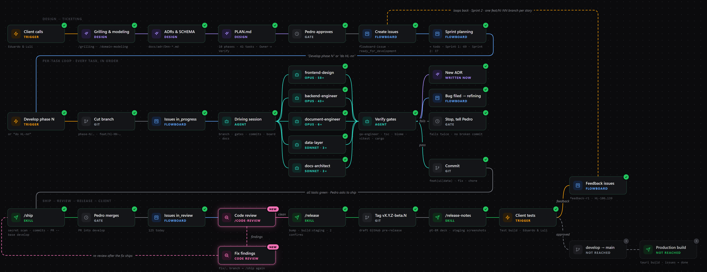

# Run view: early visual reference

Status: **reference only, not a spec.** Filed 2026-10-20. Nothing in this image is final; layout, stages, labels and styling all still need refining.

## What it's pointing at

A new screen in the Flowboard app for following one **Run** (a story or phase going through the **Workflow**) stage by stage.

Ideas in the image worth keeping in mind:

- The Workflow drawn as a node graph in three swimlanes: design → ticketing, the per-task loop, and ship → review → release → client.
- Each node shows a stage name, its kind (trigger, design, gate, Flowboard, agent, git, skill) and a short caption about what happens there.
- Per-node status badges (done, not reached).
- Fan-out to the specialist agents, with the model and how many times each was used.
- Branches (verify gates pass/fail, code review clean/findings) and loop-backs (re-review after fixes, client feedback into the next sprint) shown as labelled edges.
- Stages the Run hasn't reached yet (develop → main, production build) drawn dimmed and dashed.
